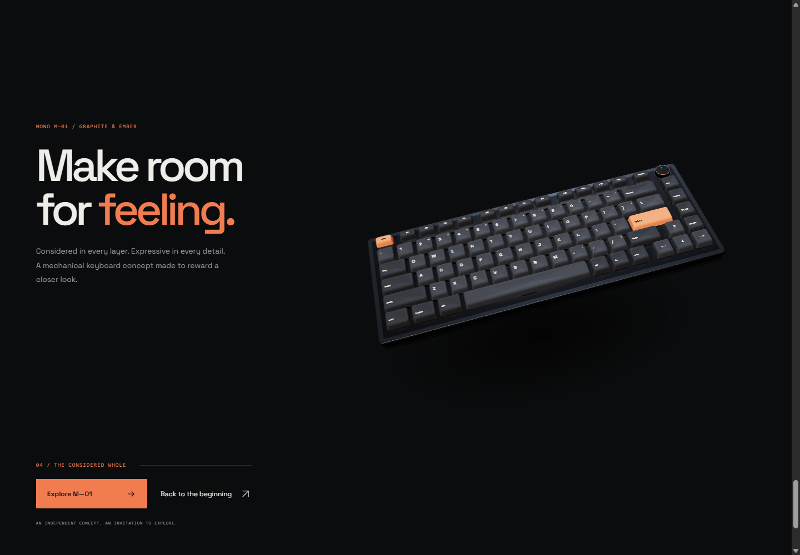

# MONO — Interactive Hardware Experience

A cinematic, scroll-driven 3D keyboard experience built with React, Vite, React Three Fiber, and GSAP. Graphite materials, restrained ember light, and one continuous product story.



MONO M—01 is an original **portfolio concept**, not a manufactured product or storefront. Its electronics and mechanism are illustrative. There is no checkout, preorder, or product-availability claim.

[Experience](#the-experience) · [Architecture](#stack-and-architecture) · [Installation](#run-locally) · [Testing](#browser-tests-and-ci) · [Performance](#performance-policy) · [Accessibility](#accessibility-and-fallbacks) · [Browser support](#browser-support-and-known-limitations) · [Hosting](#build-and-hosting) · [License](#license-and-attribution)

## The experience

- An original procedural 82-key keyboard with sculpted caps, shared legends, anodized surfaces, and a rotary dial.
- A short introductory camera arc, optional orbit / rotation, cursor lean, and subtle key lift.
- Seven internal layers with reversible scroll separation, projected component labels, and a compact mobile selector.
- An ember Escape-key close-up: cap, housing, stem, and spring separate, reassemble, and perform a keypress.
- A restrained instanced lighting wave leading to **“Make room for feeling.”**
- Native navigation, deep links, keyboard controls, reduced-motion layouts, and original SVG WebGL fallbacks.

## Stack and architecture

React 19.2 · Vite 8 · JavaScript ES modules · Tailwind CSS 4 · Three.js r182 · React Three Fiber 9 · Drei 10 · GSAP / ScrollTrigger · self-hosted Space Grotesk Variable.

One lazy-loaded canvas and keyboard assembly span the hero, construction, and finale. A single camera owner coordinates intro, orbit, and scroll. Pure sequence samplers write reusable pose buffers; CSS sticky supplies chapter pinning. The existing overview and design notes remain ordinary semantic DOM content. No router, global state library, remote textures, postprocessing pipeline, or backend is required.

```text
src/
  app/                       Application composition
  components/                Header, footer, shared UI
  content/                   Navigation destinations
  features/experience/
    keyboard/                Layout, geometry, instances, shared GPU resources
    scene/                   Pure sequences, camera fitting, lighting
    storytelling/            Chapters, callouts, scroll / DOM bridge
    ProductScene.jsx         Canvas, input, visibility, context-loss boundary
  features/story/            Overview and design principles
  hooks/                     Motion preference, GSAP lifecycle, active navigation
  styles/                    Design tokens and shared styles
tests/                       Geometry, layer, sequence, and camera tests
scripts/browser/             Portable Chrome regressions and Firefox smoke test
scripts/verify-build.mjs     Static output and lazy-chunk verification
.github/workflows/ci.yml     Lint, tests, build, Chromium regression artifacts
public/licenses/             Font license shipped with the static output
docs/                        Engineering notes, attribution, deployment procedure
```

## Run locally

Use **Node 22.21.0** from `.nvmrc` and npm. Other Node releases must match `package.json#engines`; Node 22.13 is the minimum on the Node 22 line because of ESLint.

```bash
npm ci
npm run dev
```

Open the address printed by Vite. Commands work in Git Bash, macOS, and Linux.

| Command | Purpose |
| --- | --- |
| `npm run dev` | Local Vite development server |
| `npm run lint` | Oxlint React / Hooks checks and ESLint safety checks; reject warnings |
| `npm test` | 13 geometry, layer-order, reversal, mechanism, wave, and camera tests |
| `npm run build` | Build `dist/` and verify relative assets, metadata, license, and lazy scene |
| `npm run preview` | Inspect the production build locally |
| `npm run check` | Both linters, all unit tests, and verified production build |
| `npm run test:browser` | Own temporary servers; run development and production browser suites |

## Browser tests and CI

Install Chrome or Chromium locally. The harness discovers standard executable locations; override discovery when needed:

```bash
CHROME_PATH='/path/to/chrome' npm run test:browser
npm run test:browser -- --development
npm run test:browser -- --production
```

Run `npm run build` before production browser tests. Tests create isolated profiles and random ports, close their servers / browsers, and save screenshots and JSON reports under ignored `test-results/`. Node's built-in WebSocket / process APIs provide automation; no browser framework or driver dependency is installed. The render suites use headless software WebGL and require a WebGL2-capable Chromium build.

Optional Firefox production smoke checks use native WebDriver BiDi:

```bash
FIREFOX_PATH='/path/to/firefox' node scripts/browser/firefox.mjs
```

GitHub Actions runs `npm ci`, `npm run check`, and the Chrome suites on Ubuntu, then uploads reports. This is validation only; the workflow contains no deployment, credentials, or repository write permission. A hosted CI execution can only be confirmed after the owner publishes the repository. See [Phase 5 QA notes](docs/phase-5.md) for executed coverage and limitations.

## Performance policy

Instanced keys and electronics share geometry / materials. The renderer uses demand scheduling while visible and pauses offscreen, with a DPR cap of 1.5, one 1024px shadow map, and a one-frame 128px studio environment. The held product does not continuously animate. The entire 3D implementation stays out of the initial page module through a lazy scene import.

At **1440×1000, DPR 1, headless software WebGL**:

| View | Draw calls | Triangles |
| --- | ---: | ---: |
| Hero | 38 | 72,490 |
| Exploded | 56 | 119,754 |
| Escape detail | 29 | 105,234 |
| Final | 38 | 72,490 |

These are renderer counters, not real-GPU FPS guarantees or measurements of every auxiliary pass. Shader startup, antialiasing, the shadow pass, and high-DPR screens remain costs. Full 3D code still downloads when the lazy scene mounts; lazy loading is not a claim of reduced total transfer. See [performance and accessibility audit](docs/phase-5.md).

## Accessibility and fallbacks

Semantic landmarks, descriptive headings, a skip link, real anchors, native buttons, visible focus rings, and touch-friendly controls support navigation outside the canvas. The mobile menu closes on selection, Escape, outside input, focus leaving the header, or a switch to desktop layout.

Reduced motion removes the camera flight, automatic rotation, pointer springs, scroll separation, keypress, wave, and long chapter spacers. The compact static chapters retain product information and working links. WebGL unavailable / context-loss states retain the original SVG views and semantic component controls. Context recovery currently requires reloading the page. A JavaScript-disabled visitor receives a concise concept explanation.

Useful fragments: `#construction-inspect`, `#signature-key`, and `#finale-composition`.

## Build and hosting

```bash
npm run check
npm run preview
```

`dist/` is suitable for static hosting. Vite's relative base supports root or subdirectory hosting; native fragment links require no SPA rewrite. Follow the documented [Vercel / Netlify procedure](docs/deployment.md) when deployment is authorized. There is no live deployment link in this repository.

## Browser support and known limitations

Local validation used Chrome **157.0.8103.52** for the full development / production browser suites and Firefox **127.0** for limited production smoke checks. Firefox rendered WebGL2 successfully but emitted shader-compiler warnings. Its smoke coverage is not equivalent to the Chrome regression matrix. The nine responsive sizes are automated viewport emulation, not physical-device tests. Detailed results are recorded in [the engineering audit](docs/phase-5.md#executed-validation).

- Software-renderer automation does not certify physical mobile GPUs, battery / thermal behavior, or assistive-technology compatibility.
- Safari / WebKit and real touch-device validation remain required before broad browser-support claims.
- Close-up legends and procedural materials have a deliberately bounded detail budget.

## License and attribution

**No application-wide license has been selected.** Public source visibility does not grant a blanket open-source license for MONO's code or artwork. A license can be added later by the owner; none is implied here.

Space Grotesk uses SIL OFL 1.1; its [original notice](public/licenses/space-grotesk-OFL.txt) ships with the production output. Dependencies retain their own licenses. MONO's geometry and procedural artwork are original; no reference textures, external HDRs, or commercial product models are bundled. See [asset and dependency attribution](docs/attribution.md).

Engineering history: [Phase 2](docs/phase-2.md) · [Phase 3](docs/phase-3.md) · [Phase 4](docs/phase-4.md) · [Phase 5](docs/phase-5.md).
