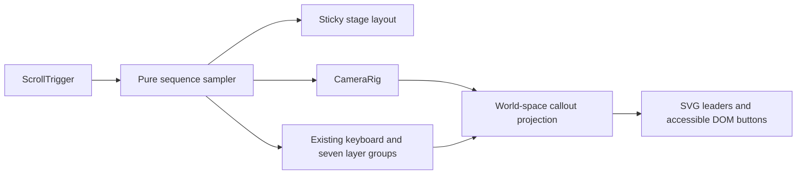

# Phase 03 — Exploded view and scroll storytelling

Historical Phase 03 record. [Phase 04](phase-4.md) extends the same camera owner and canvas with the signature-key finale; the measurements below remain its baseline.

Phase 03 extends the existing MONO M—01 model and React / Vite application. The original key layout, cap geometry, material system, hero, and lazy WebGL boundary are retained. There is one canvas and one keyboard assembly across the hero and construction chapter. No dependencies, standalone HTML implementation, final CTA sequence, or Git commit are introduced.

## Ownership and architecture

- **Experience.jsx** composes the existing hero, shared visual stage, and semantic construction section. It owns stable motion refs, component selection, and static-mode availability.
- **useSceneScroll.js** measures the hero slot and chapter, samples actual document scroll, positions the shared stage, and requests a render. CSS sticky supplies the pinning; no pin spacer, canvas reparenting, or scroll hijacking is needed.
- **sequence.js** is the only source of layer offsets, camera shot channels, callout visibility, and interaction weight. It writes into reused buffers and is independent of React, GSAP timing, previous frames, and scroll direction.
- **CameraRig.jsx** coordinates the introductory reveal, manual hero orbit, and scroll sequence. It captures the current hero orbit at the handoff and restores it on reverse travel.
- **KeyboardModel.jsx** keeps the original cap batches and assembly. Seven group refs receive additive layer offsets; hidden internal geometry becomes visible during separation.
- **ComponentCallouts.jsx** keeps interactive labels in the DOM, outside the WebGL error boundary. **CalloutProjector.jsx** projects real layer anchors into SVG leader lines after the camera and assembly have updated.
- **Construction.jsx** supplies descriptions, numbered selectors, native anchors, and the mobile presentation. **useActiveSection.js** updates navigation from section visibility without rewriting history.

Frame ordering is explicit: OrbitControls runs first, CameraRig at priority -0.8, the model at -0.4, and callout projection at 0. No positive-priority callback takes over rendering. Hero orbit, automatic rotation, cursor lean, and hover lift cannot write competing transforms during the scroll-owned chapter.

Pure shot presets live separately from Three.js camera math so the eager page shell does not pull the WebGL engine out of its lazy chunk.

## Sequence

The normal construction section occupies 400 small viewport heights on desktop and 360 on compact screens. The scroll interval starts as the chapter enters the viewport and ends where its sticky presentation releases. The start is clamped at document zero so tall displays still begin with an interactive assembled hero.

| Normalized progress | Behavior |
| --- | --- |
| 0–0.24 | Hero-to-construction layout and camera handoff |
| 0.24–0.58 | Smooth separation of the seven layers |
| 0.58–0.83 | Fully exploded inspection hold |
| 0.83–1 | Reassembly and transition toward the next section |

Smoothstep ramps reach exact endpoints without overshoot. Every layer uses the same spread factor against ordered offsets, so reversing scroll reproduces the same positions. No numerical spring or elapsed-time accumulator drives the construction sequence.

The camera fits all component bounds as the stack expands. Its vector, quaternion, matrix, and pose buffers are reused. The existing hero springs remain isolated to hero interaction.

## Seven internal layers

| Layer | Assembled group Y | Full additive offset | Details |
| --- | ---: | ---: | --- |
| Keycaps | 0.51 | +5.80 | Original 82 sculpted caps and shared legend atlas |
| Mechanical switches | 0.37 | +4.20 | Open upper housings, lower housings, return springs, cross stems, contact pins, stabilizers, rotary encoder |
| Aluminium plate | 0.295 | +2.70 | Real switch, stabilizer, and encoder apertures |
| Acoustic foam | 0.16 | +1.20 | Porous sheet with matching mechanical clearances |
| PCB / electronics | -0.065 | -0.25 | Illustrated copper traces, plated contacts, per-key LEDs and diodes, controller packages, capacitors |
| Battery modules | -0.18 | -1.70 | Two foil pouch cells, original labels, insulation, leads, and connector |
| Lower enclosure | 0 | -3.60 | Hollow walls, lower floor, rim, bosses, screws, recessed port, and feet |

The enclosure group origin is not its floor height; the tray surrounds the internal components in the assembled state. Ordering tests use physical anchor heights, while exploded-gap tests use each layer's component bounds.

The plate and foam are perforated geometry rather than painted grids. Ray tests verify clear switch apertures and solid surrounding web. The enclosure is hollowed from the existing case rather than substituted with a new keyboard model.

Switch details and electronics use shared geometry, merged static parts, and instanced meshes. Small switch housings use reduced corner tessellation; the original visible keycap geometry is unchanged. PCB and battery artwork are generated locally. Electrical routes and cell labels are illustrative, not manufacturing drawings or product capability claims.

## Labels, responsive layout, and accessibility

Desktop labels project an anchor on each actual layer into the shared stage. Their vertical positions are separated to avoid overlapping controls, while the leader endpoints remain attached to the moving parts. Selection changes the construction readout and highlights the corresponding leader.

Below the desktop label threshold, the page uses seven numbered buttons and a concise component summary. Short landscape viewports use two columns so the model, selector, and continuation link remain reachable. That compact layout applies only in landscape. Short portrait screens reserve a smaller product frame and anchor the details above the viewport bottom. Narrow portrait selectors scroll within their own row to retain 44px buttons without overflowing the page. All component controls use native buttons with pressed state and visible focus styling.

The native anchors have distinct purposes:

- `#construction` opens the chapter introduction.
- `#construction-inspect` lands within the fully exploded hold.
- `#overview` continues into the existing next section after the scene releases.

Cold fragment loads are aligned after font measurement, unless the visitor has already interacted. The scene reads that position before starting its intro; deep links do not replay a hero flight. The browser continues to own ordinary link history and scrolling.

Reduced motion and unavailable WebGL use the same static-mode contract: an assembled hero and a static exploded construction view with only one viewport of chapter content. A live mode switch preserves the active construction chapter. Static height is committed with the React state and bookmark restoration; a separate media-query height rule was removed because it could shorten the chapter before that restoration ran. Scroll anchoring is disabled within this controlled chapter to avoid competing automatic adjustments.

WebGL initialization failure and context loss retain the semantic descriptions, component controls, native links, and original SVG construction schematic. Failed renderers are removed; recovery requires a reload. Deliberate context-failure tests may emit expected renderer diagnostics during teardown.

## Rendering measurements

Measurements use headless Chrome with software WebGL at a 1440 × 1000 emulated viewport and DPR 1. A fresh frame is requested and sampled from React Three Fiber's after-frame callback, rather than accidentally reading a standalone environment-map subpass.

| Scene state | Reported draw calls | Reported triangles | Renderer geometries | Renderer textures |
| --- | ---: | ---: | ---: | ---: |
| Assembled hero | 38 | 72,490 | 46 | 9 |
| Fully exploded | 56 | 119,754 | 65 | 11 |

The held exploded view produced zero additional frames during the idle sampling interval. Hidden internals remain allocated after first use for reuse on reverse travel; their draw work is skipped when assembled.

The DPR cap remains 1.5. The studio retains a 128px environment capture, one 1024px shadow map, existing lights, and no fullscreen postprocessing. StudioLighting is memoized so changing the DOM layer readout does not recreate the environment. There are no per-key point lights or remote texture requests.

These renderer counters are not a real-GPU FPS benchmark or a measurement of all auxiliary GPU passes. Shader preparation, software-renderer startup, high-DPR devices, and shadow work remain material costs. Physical mobile GPU, thermal, Safari, and Firefox validation remain outstanding.

## Validation

`npm run check` runs lint with warnings rejected, the Node test suite, and the production build.

The eight automated tests cover the original layout, cap surfaces and camera fitting, plus seven-layer ordering, full exploded clearances, animation boundaries and hold, exact reverse sampling, buffer reuse, expanded camera framing, and real plate / foam apertures.

The local browser harness is `.local/qa-phase3.mjs`. It checks rendered states before sampling, compares forward and reverse camera / layer positions, checks a persistent canvas, exercises native Enter activation, and verifies anchor coordinates, mode changes, initial reduced-motion loading, context loss, and unavailable WebGL. Reports and screenshots remain in ignored `.local/` files. The machine-specific harness is not presented as portable CI coverage.

The full responsive matrix includes 320 × 740, 390 × 844, 768 × 1024, 844 × 390, 1024 × 800, 1440 × 1000, and 1920 × 1080. A final focused production regression also covers 320 × 568 and 568 × 320, and repeats 320 × 740 and 844 × 390. It verifies a usable product viewport, 44px component buttons, reachable continuation controls, and no page overflow. Reports and screenshots for this check use `.local/qa-phase3-small.mjs` and `.local/phase3-small-viewport-report.json`.

Validation completed in this continuation:

| Check | Result |
| --- | --- |
| Oxlint, warnings rejected | Pass |
| Eight Node tests | Pass |
| Vite production build | Pass, no bundle warnings |
| Development Chrome: seven forward states and reverse travel | Pass |
| Production Chrome: complete browser suite | Pass |
| Persistent canvas and camera ownership boundary | Pass |
| Keyboard Enter, layer selection, and native anchors | Pass |
| Seven responsive viewport sizes and reachable controls | Pass |
| Final short portrait / landscape production regression | Pass, four sizes including 320 × 568 and 568 × 320 |
| Live reduced-motion changes and chapter preservation | Pass |
| Reduced-motion cold load and inspection deep link | Pass |
| Mobile navigation and active-section state | Pass |
| Context loss, unavailable WebGL, and functional static controls | Pass |

Normal operation in the full development and production suites produced no uncaught runtime errors, console warnings, or failed requests. The final focused viewport run also completed without uncaught runtime errors. Deliberate WebGL fault injection is recorded separately from normal-operation diagnostics. Full suites preceded the final viewport-specific correction; lint, all eight tests, production build, and the focused production viewport regression passed after that correction.

## Main Phase 03 source changes

| Area | Files |
| --- | --- |
| Composition and hero integration | `App.jsx`, `Experience.jsx`, `Hero.jsx`, `SceneStage.jsx`, `ProductScene.jsx` |
| Keyboard internals and shared resources | `keyboard/layers.js`, `internals.js`, `InternalLayers.jsx`, `KeyboardModel.jsx`, `resources.js`, `geometry.js`, `textures.js`, `layout.js` |
| Camera and sequence ownership | `scene/sequence.js`, `presets.js`, `shots.js`, `CameraRig.jsx`, `StudioLighting.jsx` |
| Construction presentation | `storytelling/useSceneScroll.js`, `Construction.jsx`, `ComponentCallouts.jsx`, `CalloutProjector.jsx`, `construction.css` |
| Fallbacks and navigation | `SceneBoundary.jsx`, `SceneFallback.jsx`, `navigation.js`, `SiteHeader.jsx`, `useActiveSection.js`, story section numbering |
| Verification and documentation | `tests/sequence.test.js`, README, these notes, historical Phase 02 cross-reference |

## Phase 04 recommendations

Add the final CTA and dedicated product-detail camera sequence through the existing single camera owner. Profile physical devices before adding optional visual effects or changing resolution policy. Convert the local browser checks into a portable automated harness and expand browser / touch coverage before publication. No Phase 04 features are implemented here.
